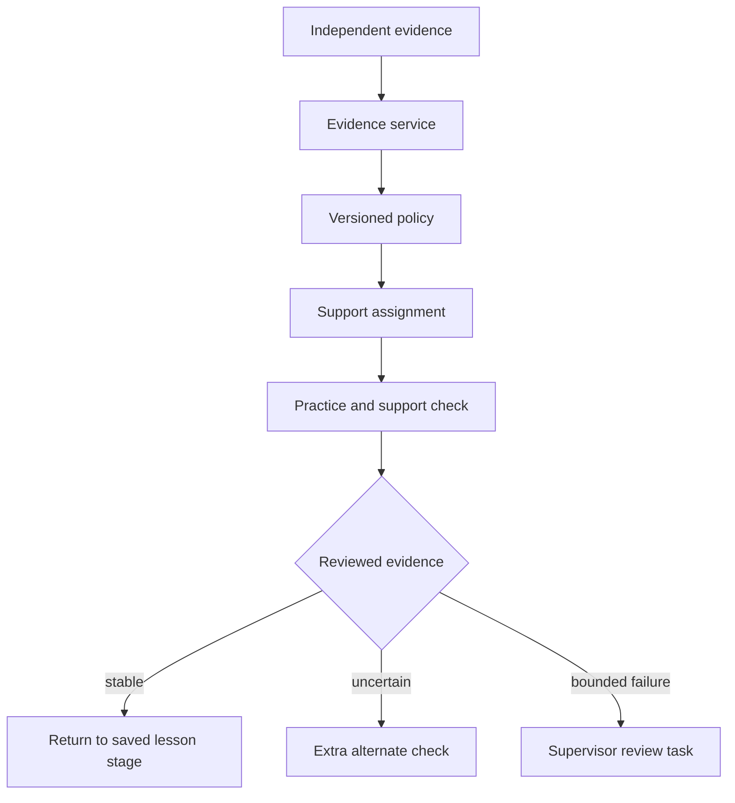

# هِمّة V2 — فحص P01-E للتكيف والتقوية والمراجعات

**التاريخ:** 2026-10-19

**الحالة:** `ready_for_review_source_only` — لا تشغيل شامل أو تعديل كود/DB/نشر

**فرع العمل:** `v2/01-learning-foundation-20261007`

**HEAD المفحوص قبل التوثيق:** `f9fca5921d4e667ee1524cfd601fb5e80a4f6ad5`

**مرجع V1:** `stage/02-content` عند `4ecb27590f7c19cbe7823804b9919d91000415ef`

## 1. الخلاصة التنفيذية

V1 يملك أساسًا مهمًا لا يجوز إسقاطه: قرار تكيف قابل للتفسير، منع الخفض التلقائي، تقوية منضبطة بلا اختيار عشوائي، دورة `ضعف → تقوية → تحقق → عودة/تصعيد`، عزل الجلسة الحالية عن التاريخ، مراجعة بشرية رقمية للقراءة، إبقاء التسجيلات السابقة، وإعادة تسجيل يفتحها الطالب صراحة. لكن هذه الآلية **ليست سياسة V2** ولا يمكن نقل عتباتها أو كتالوجها كما هي.

الفجوات الحرجة المؤكدة:

1. السياسة الحية ما تزال ثابتة على 10 أنشطة/مستوى وعتبات `50/70/80/85` وترقية بعد 6، بينما V2 يعتمد 19 درسًا و13 مهارة و12 دعمًا ويمنع اعتماد عتبات جديدة قبل المعايرة.
2. نتيجة نشاط Core واحدة أقل من 70 تُنشئ دعمًا فوريًا؛ هذا يخالف قرار V2: الخطأ الواحد لا يوجب الدعم، والدليل يجب أن يأتي من تحقق مستقل لا تدريب موجه.
3. Runtime لا يقرأ `support_group_id`, `focus_item_map`, `skill_group`, `evidence_type`, `error_focus`, أو أدوار `guided_practice/independent_check/support_check` من بنك V2.
4. التحقق بعد تقوية V1 يعيد فتح **نفس خطوة السؤال الفاشلة**، بينما V2 يطلب تحققًا قصيرًا بمادة بديلة من بنك الدعم ثم عودة إلى موضع الدرس المحفوظ.
5. `GET /adaptation/status` ليس read-only؛ يستدعي تقييمًا قد ينشئ قرارات ومكافآت، والواجهة تستطلعه كل 1.8 ثانية. هذا يخلق مالك حالة إضافيًا ومخاطر race/كتابة من GET.
6. مراجعة القراءة سليمة في أجزاء مهمة، لكن القراءة منخفضة الدرجة لا تتحول دائمًا إلى `failed_step` لأن حقل التوافق يصبح صحيحًا لأي rubric أكبر من صفر. ولا توجد مراجعة كتابة أو `ReviewTask` موحدة.

القرار: **نحافظ على invariants والسجل التاريخي، ونستبدل سياسة V1 بعقد أدلة V2 وإسناد دعم مفسر ومثبت بالإصدار.** لا نبني محركًا موازيًا ولا نستخدم الواجهة أو polling كمالك للقرار الأكاديمي.

## 2. ما فُحص فعليًا

- السياسة والحالة: `adaptation.py`, `adaptation_runtime.py`, `learning_state_machine.py`, `level_completion.py`.
- دورة التقوية: `reinforcement_mapping.py`, `reinforcement_cycles.py`, `reinforcement_review.py`, ونماذج DB/migrations.
- التشغيل والعودة: `activities.py`, `activity_runtime.py`, `journey.py`, `protected.py`.
- القراءة والمراجعة: `audio_review_state.py`, `review.py`, `assessment_completion.py`, `recordings.py`.
- الواجهات: `StudentAdaptiveHoldOverlay`, `StudentRerecordTasks`, `ReinforcementReviewPanel`, لوحة مراجعة الصوت، وصفحات النشاط/اللوحة.
- التنبيهات والتقارير: `notification_events.py`, `admin_notifications.py`, `skill_reports.py`, `reports.py`.
- الاختبارات التاريخية: adaptation/recovery/scenario matrix، reinforcement cycle/mapping/review، audio boundaries/queue/rerecord، journey وW6.
- بنك V2: 13 مهارة، 12 دعمًا (4/3/5)، 89 بند دعم (43 تدريبًا +46 تحققًا)، وحقول `focus_item_map/error_focus/evidence_type/role`.

**حد الإثبات:** فحص مصدر ومقارنة Git، مع فحص syntax منفرد لـ`adaptation.py`. لم تُشغّل suite أو DB/Browser/Audio/Visual QA، ولا يعني هذا التقرير اجتياز Runtime.

## 3. مقارنة V1 مع فرع V2

- معظم نواة P01-E متطابقة Git blob بين V1 وHEAD: runtime/cycles/mapping/audio state/review/state machine/completion/notifications والواجهات الثلاث ولوحة الصوت.
- فرق V2 المفيد في `adaptation.py`: استبعاد `reinforcement_activity` من نافذة إتقان Core، كي لا تصبح التقوية دليل ترقية. **KEEP**.
- فرق V2 المفيد في `reinforcement_review.py`: قصر خيارات المشرف على `status=approved`. **KEEP**.
- لا يوجد ربط جديد لبنك V2 أو support/focus، ولا تشغيل حديث يثبت عدم عودة العيوب القديمة.

## 4. قدرات V1 التي نحافظ عليها

| ID | القدرة | القرار | الدليل |
|---|---|---|---|
| AE-K01 | لا automatic demotion ولا قفز أكثر من مستوى | `KEEP INVARIANT` | `decide_transition`, `_transition_level_session` |
| AE-K02 | دليل الجلسة الحالية معزول عن جلسات التاريخ | `KEEP` | `_valid_signals(...session_id)`, scenario tests |
| AE-K03 | pending/rerecord صوت محايد، والـgraded فقط دليل أكاديمي | `KEEP/GENERALIZE` للقراءة والكتابة | `audio_review_state.py`, `_attempt_signal` |
| AE-K04 | rubric القراءة الرقمي لا يختزل إلى Boolean في حساب الإتقان | `KEEP` | `AudioReview.rubric_score`, `_attempt_signal` |
| AE-K05 | أحدث تسجيل هو الحالة الحية، والقديم يبقى تاريخًا immutable | `KEEP` | `latest_audio_submission`, review queue |
| AE-K06 | إعادة التسجيل مهمة مؤجلة تفتح باختيار الطالب ولا تمحو السابق | `KEEP/REMODEL AS TASK` | audit open action وrerecord endpoints |
| AE-K07 | دعم مطابق للمستوى ومعتمد، بلا random fallback | `KEEP PRINCIPLE` مع دعم فجوة سابقة المقصود في V2 | mapping rules وapproved filters |
| AE-K08 | دورة durable تربط القرار والدليل والدعم والتحقق والتصعيد | `KEEP CONCEPT/REFACTOR` | `ReinforcementCycle` |
| AE-K09 | لا تُستبدل التقوية بإتقان؛ يجب تحقق مستقل بعدها | `KEEP` | source attempt reopening/cycle status |
| AE-K10 | حد لمحاولات التحقق وتصعيد للمشرف بدل loop | `KEEP/REFINE` | `max_verification_rounds`, `escalated` |
| AE-K11 | تدخل المشرف بسبب موثق وAudit وصلاحية researcher | `KEEP` | manual override/assignment و`get_current_user` |
| AE-K12 | تنبيه durable عند تسجيل جديد أو تصعيد تقوية | `KEEP/EXTEND` | `notification_events.py` |
| AE-K13 | المكافأة حدث idempotent لا تتكرر بالـrefresh | `KEEP AFTER POLICY REVIEW` | `RewardEvent` unique key |
| AE-K14 | الفصل بين تقرير وصفي والقرار الأكاديمي | `KEEP/EXTEND` | `skill_reports.py` يصرح `is_mastery_score=false` |

لا يوجد `RETIRE_APPROVED`. تزال العتبات والكتالوجات القديمة فقط بعد بديل V2 مختبر، ولا تزال سجلات القرارات/المراجعات المفيدة أثناء refactor.

## 5. حقائق بنك V2 المؤثرة

| الحقيقة | العدد/العقد | أثرها على التنفيذ |
|---|---|---|
| مجموعات الدعم | 12: L1=4، L2=3، L3=5 | ليست 35 `reinforcement_activity` V1 |
| بنود الدعم | 43 guided practice +46 support check | التدريب لا يدخل evidence؛ التحقق فقط وفق policy |
| اختيار التحقق | بندان لكل focus في البنك الحالي | لا تعرض كل أسئلة مجموعة الدعم ولا تعيد السؤال الأصلي |
| القراءة داخل الدعم | 6 تدريب +8 تحقق | تحتاج review state وسياسة متابعة/عودة |
| الكتابة داخل الدعم | 4 تدريب +4 تحقق | تحتاج Writing Review غير موجودة حاليًا |
| القرار | `skill_group + error_focus → support_group + focus` | لا يكفي `ContentItem.skill_id` أو متوسط نشاط كامل |

رُصدت 31 قيمة `error_focus` في أسئلة التحقق و23 مفتاح focus في مجموعات الدعم، ولا يوجد في Runtime أو البنك جدول تحويل صريح بين المصطلحات غير المتطابقة مثل `short_long_confusion → alif/waw/yaa` أو `who_confusion → find_explicit_answer`. يجب اعتماد mapping صريح قابل للاختبار؛ لا يجوز التخمين النصي.

## 6. سجل الفجوات والأسباب الجذرية

| ID/أولوية | مكان V1 ووظيفته | القصور/السبب الجذري | هدف V2 والحفاظ | اختبار الإغلاق |
|---|---|---|---|---|
| AE01 `P0` | constants في `adaptation/learning_state/level_completion` | `10/6` وعتبات `50/70/80/85` سياسة V1 غير معايرة لـ19 درسًا | PolicyVersion V2 من config/release، بلا magic duplicates؛ حفظ منع demotion | boundary matrix من سياسة موقعة |
| AE02 `P0` | `evaluate_student`: آخر نشاط <70 | خطأ/نتيجة واحدة ترسل للدعم فورًا | evidence pattern: نجاح/ملتبس/ضعف متكرر؛ خطأ واحد لا يكفي | سؤال خاطئ واحد ثم نجاح، لا support |
| AE03 `P0` | 35 ContentItem تقوية V1 | لا Support entity/assignment/stage ولا استيراد 12 دعمًا | SupportDefinition/Assignment مثبتان بالإصدار وfocus | compile 12/89 وعرض 2 check فقط |
| AE04 `P0` | `_attempt_signal` يحسب كل step في Core item | لا role، فيختلط guided hinted مع independent evidence | EvidenceEvent يحمل role؛ GP feedback فقط، IC/support_check قياس | نفس الأداء في GP/IC لا يعطي النتيجة نفسها |
| AE05 `P0` | mapping على `Skill.id/canonical code` القديم | لا `error_focus → support focus` صريح ولا `focus_item_map` | Mapping معتمد ومغلق التغطية للـ13 مهارة وكل أخطاء القياس | contract coverage بلا unmapped/ambiguous |
| AE06 `P0` | cycle يعيد فتح source step نفسه | حفظ جواب/تحيز، ولا bookmark لمرحلة الدرس أو مادة بديلة | Support check بديل ثم `return_to` الدرس/المرحلة والسؤال التالي | دعم ناجح يعود لنقطة الأصل بلا تكرار |
| AE07 `P0` | دعم V1 يعامل النشاط كوحدة فورية | 14 قراءة و8 كتابة في دعم V2 قد تبقى pending؛ WritingReview غائبة | ReviewTask reading/writing وسياسة متى يستمر ومتى ينتظر | pending/approve/rewrite داخل support |
| AE08 `P1` | `failed_step_ids` يعتمد Boolean؛ grade يضع true إذا rubric>0 | قراءة ضعيفة غير صفرية تخفض المتوسط لكن لا تحدد خطوة فاشلة للدورة | Evidence رقمي مع threshold/error focus من review، لا compatibility bool | rubric 0/0.2/حد النجاح/1.0 |
| AE09 `P1` | mapping يفرض same-level | لا دعم مدمج لفجوة سابقة مع بقاء الطالب في مساره الحالي | support level مستقل عن assigned level مع منع demotion وعودة صحيحة | طالب L2 بفجوة L1 ثم عودة L2 |
| AE10 `P1` | `GET /adaptation/status` يستدعي `evaluate_student/ensure_rewards` | GET يكتب قرارات/مكافآت، وتستطلعه الواجهة كل 1.8s | Queries read-only؛ command idempotent بعد evidence event/worker؛ owner واحد | GET متكرر لا يغير DB/query count محدود |
| AE11 `P1` | mapping gap يظهر overlay؛ لا Cycle/notification | لا تنبيه للمشرف، ولا CurrentAction دائم؛ قد يبقى الطالب محجوبًا بصمت | ReviewTask/notification عند نفس transaction و`supervisor_hold` في journey | gap يظهر للمشرف والطالب بعد refresh |
| AE12 `P1` | Overlay داخل activity فقط و409 نصي | dashboard/profile لا يملكان الحالة؛ الرسالة “لا يوجد خطأ” مضللة رغم ضعف مثبت | CurrentAction discriminated ورسالة مساعدة غير وصمية ودقيقة | direct URL/dashboard/back/offline |
| AE13 `P1` | unique للدورة على decision فقط | لا قيد يمنع أكثر من active cycle لنفس session/focus مع concurrency | partial unique/locking/idempotency للقرار والإسناد والانتقال | double request/tab/race |
| AE14 `P1` | `verification_round` عداد عالمي للدورة | خطآن عبر خطوتين قد يصعدان مبكرًا؛ ولا حالة evidence ملتبس/تحقق إضافي | rounds واضحة لكل assignment/check attempt وبنك بدائل محدود | multi-step wrong/correct/bounded escalation |
| AE15 `P1` | لوحة الإسناد تعرض كل تقويات المستوى | المشرف يستطيع اختيار نشاط غير مطابق للمهارة/focus؛ السبب وحده لا يكفي | خيارات compatible فقط، والاستثناء يحتاج صلاحية/تحذير وعقد موثق | forged item_id وfocus mismatch |
| AE16 `P1` | رفض التسجيل يغير status ويكتب Audit عام | ملاحظات UI لا تحفظ عند rerecord، ولا Review row/سبب structured | ReviewDecision immutable لكل approve/rerecord مع feedback مناسب للطفل | رفض بملاحظة، تاريخ القرار، concurrent review |
| AE17 `P1` | queue خاصة بالصوت ولا claim/assignment | لا كتابة، ولا task موحد/status owner/SLA أو منع مشرفين من فتح نفسه واجهيًا | ReviewTask queue reading/writing مع optimistic/row lock وaudit | reviewer A/B، filtering، stale task |
| AE18 `P1` | stars/badges مبنية على item attempts وعتبات V1 | معنى “نشاط” وhint/retry تغير؛ قد تكافئ تدريبًا أو دعمًا قبل evidence مستقر | RewardPolicy على event معتمد بعد مراجعة، مرة واحدة | pending/retry/support/refresh |
| AE19 `P1` | skill report يجمع كل retries حسب item skill | لا role/focus/review status، فيخلط التدريب والتحقق والدعم وإن كان وصفيًا | تقارير تفصل source/role/focus/review/release وتبقى غير متحكمة بالمسار | reconciliation بين evidence والقرار والتقرير |
| AE20 `P1` | suites تاريخية واسعة لـV1 125/35 | لا اختبارات بنك 300/12 supports/focus/writing/cross-level، ولا run على HEAD | مصفوفة AE-T01–AE-T24 أدناه مع SHA وfixtures | CI/API/E2E/visual evidence |

## 7. المعمارية المستهدفة

- `EvidenceEvent`: student/session/release/question/role/skill_group/error_focus/result/review_status/hint_used.
- `SupportAssignment`: support_group/focus/source_lesson/source_stage/return_to/status/round/policy_version.
- `ReviewTask`: reading أو writing، latest response، claim/decision/feedback/audit.
- `AdaptationPolicy`: pure evaluator لا يكتب DB ولا يُستدعى من GET؛ command service يثبت القرار idempotently.
- `CurrentAction`: lesson stage/support/pending review/rerecord/supervisor hold/posttest، وهو المصدر الوحيد للواجهة.
- ترحيل تدريجي يحافظ على الجداول والسجلات الصحيحة عبر adapters؛ لا تغيير أسماء الدوال السليمة أو نسخ المحرك.

## 8. مصفوفة الاختبارات المطلوبة

| ID | السيناريو | النوع | الحالة |
|---|---|---|---|
| AE-T01 | compiler يثبت 13 مهارة و12 دعمًا و43/46 وfocus map | contract | `NOT_VERIFIED` |
| AE-T02 | كل error focus له mapping واحد معتمد أو hold صريح | contract/property | غير منفذ |
| AE-T03 | خطأ مستقل واحد لا يرسل للدعم | policy | غير منفذ |
| AE-T04 | hinted GP لا يدخل mastery/evidence | policy/security | غير منفذ |
| AE-T05 | ضعف متكرر يختار support group/focus الصحيح | integration | غير منفذ |
| AE-T06 | نتيجة ملتبسة تعطي alternate check لا loop | policy/E2E | غير منفذ |
| AE-T07 | support يعرض focus واحدًا وبندَي تحقق فقط | API/E2E | غير منفذ |
| AE-T08 | نجاح الدعم يعود إلى lesson/stage المحفوظ | DB/E2E | V1 مفهوم فقط؛ V2 غير منفذ |
| AE-T09 | فشل محدود يصعّد مرة واحدة للمشرف | concurrency/E2E | V1 جزئي |
| AE-T10 | فجوة مستوى سابق داخل المسار الحالي بلا demotion | policy/E2E | غير منفذ |
| AE-T11 | pending reading/writing محايد ولا يمنح mastery/reward | API/report | audio V1 جزئي؛ writing غائب |
| AE-T12 | rubric القراءة يحدد weakness/focus دون Boolean خاطئ | unit/integration | غير مغطى |
| AE-T13 | مراجعة كتابة approve/rewrite/history | full-stack | غير منفذ |
| AE-T14 | rerecord يحفظ التسجيل والقرار والملاحظة والتاريخ | API/E2E | V1 جزئي؛ reason ناقص |
| AE-T15 | مشرفان يراجعان المهمة نفسها دون قرارين متعارضين | concurrency | backend lock جزئي |
| AE-T16 | mapping gap ينشئ تنبيهًا وCurrentAction دائمًا | integration/E2E | غير منفذ |
| AE-T17 | GET status/reload لا يكتب أو يكرر قرارًا/مكافأة | API/DB | السلوك الحالي مخالف |
| AE-T18 | double-click/tabان لا ينشئان دورتين أو assignmentين | concurrency | تغطية جزئية |
| AE-T19 | release N يبقى لقرار/دعم الجلسة بعد N+1 | DB/integration | غير منفذ |
| AE-T20 | reward مرة واحدة بعد حدث مستقر لا pending/GP | regression | V1 جزئي |
| AE-T21 | التقرير يفصل GP/IC/support/review/focus/release | report contract | غير منفذ |
| AE-T22 | الهاتف/اللوحي/الديسكتوب: support/hold/review/rerecord | visual+axe | تاريخي جزئي فقط |
| AE-T23 | offline/409/503/back/refresh لا يفقد return point | network E2E | غير منفذ |
| AE-T24 | parity لـAE-K01–AE-K14 وعدم عودة RG04/05/06/12/15/16/25 | regression | لا run حديث |

## 9. ما لم يُعتبر منجزًا

- لم تُعتمد عتبات V2 أو سياسة evidence تربويًا.
- لم يُستورد بنك الدعم V2 ولم تُبن SupportAssignment/ReviewTask/WritingReview.
- لم تُشغّل اختبارات API/DB/E2E أو screenshots أو مراجعة صوتية فعلية.
- لم تُعتبر اختبارات V1 التاريخية نجاحًا لفرع HEAD.
- لم يتغير Runtime أو DB أو النشر.

## 10. حالة التسليم

- `P01-D = approved_source_audit` باعتماد المالك «تم» في 2026-10-19؛ اختبارات D المؤجلة لم تصبح ناجحة بهذا الاعتماد.
- `P01-E = ready_for_review_source_only` مع الفجوات `AE01–AE20`.
- `P01` الكلية ما تزال `in_progress`.
- **P01-F وP02 لم تبدأا**، ولا يبدأ أي منهما قبل اعتماد مستقل «تم».
