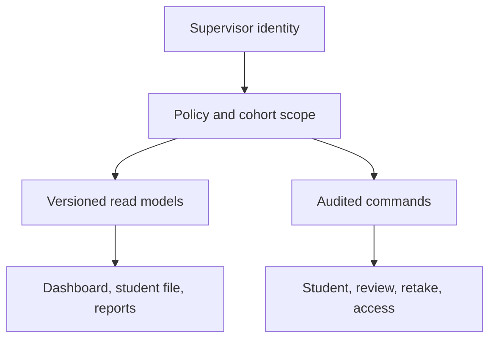

# هِمّة V2 — فحص P01-F الكامل للمشرف والإدارة والتقارير

**التاريخ:** 2026-10-19

**الحالة:** `ready_for_review_source_only` — فحص مصدر وتخطيط فقط؛ لا تشغيل شامل أو تعديل كود/DB/نشر

**فرع العمل:** `v2/01-learning-foundation-20261007`

**HEAD المفحوص قبل التوثيق:** `298b7e24999ebd9bda4d1f438238f534f494f962`

**مرجع V1:** `stage/02-content` عند `4ecb27590f7c19cbe7823804b9919d91000415ef`

## 1. الخلاصة التنفيذية

واجهة المشرف في V1 ليست صفحة ثانوية يمكن استبدالها بلوحة جديدة؛ هي مجموعة وظائف متكاملة تشمل لوحة المتابعة، إنشاء الطلاب وإدارتهم، رموز الدخول، فتح البعدي، ملف الطالب متعدد التبويبات، مراجعة الصوت، معاينة المحتوى والإجابات، الإشعارات، الحساب وكلمة المرور والمشرفين، التقارير الفردية والجماعية وتصدير PDF/XLSX، وتقارير المهارات. كل ذلك يدخل سجل المحافظة ولا يوجد في P01-F أي `RETIRE_APPROVED`.

المصدر الحالي يحفظ أجزاء قوية: حماية المسارات بالدور، إبطال الجلسات عند تغيير كلمة المرور/رمز الطالب/التفعيل، Audit لمعظم الأفعال الحساسة والتصدير، قفل إنشاء الطلاب، بوابة البعدي الخادمية، معاينة محتوى readonly منفصلة عن DTO الطالب، تقارير لا تغيّر الحالة الأكاديمية، وتصميم Admin responsive مع route توافق للحساب القديم. لكن المنظومة الحالية ما تزال واجهة V1 وعقودها، وليست جاهزة لتشغيل V2.

أهم الفجوات المؤكدة:

1. كل حساب يحمل الدور العام نفسه `researcher`؛ أي مشرف يستطيع إنشاء مشرفين، رؤية كل الطلاب والأكواد، تغيير الحالة الأكاديمية، ومشاهدة/تصدير كل التقارير. لا توجد صلاحيات دقيقة أو نطاق عينة.
2. API إعادة الاختبار وسجل المحاولات موجودان ومختبران خلفيًا، لكن ملف الطالب لا يستدعيهما إطلاقًا؛ الميزة غير قابلة للاستخدام من لوحة المشرف.
3. اختيار التقرير لمحاولة القبلي/البعدي يعتمد آخر صف بالـID ولا يستخدم `official_for_reporting`. بدء إعادة غير مكتملة بعد نتيجة رسمية قد يحجب الدرجة الرسمية والتسكين والتحسن.
4. الإشعارات Inbox عالمي؛ `ResearcherNotification` لا يملك مستلمًا ولا جدول قراءة لكل مشرف. قراءة مشرف واحد أو «قراءة الكل» تخفيها عن الجميع.
5. لوحة الطلاب والـDashboard يعتمدان إسقاط V1 ذي 10 أنشطة، ويحمّلان كل الطلاب إلى المتصفح مع أكواد دخولهم ثم يبحثان محليًا؛ لا يصلح ذلك لعقد V2 أو التوسع وتقليل كشف الرموز.
6. معاينة المحتوى تسحب كل `ContentItem.status=approved` ولا تربط العناصر بالإصدار النشط، وتدعم أنواع V1 لا درس V2 ذي المراحل والفيديو والكتابة والدعم/focus/release.
7. تقارير المهارات تجمع كل retries والتدريب والتقوية والمحاولات غير الرسمية كملاحظات متساوية؛ والتقارير العامة لا تعرض release/evidence role/review state/support focus أو الكتابة. هذا غير كافٍ لدليل V2 البحثي.
8. إدارة المشرفين لا تدعم تعطيل/إعادة تفعيل/إعادة ضبط/فرض تغيير كلمة المرور أو منع تعطيل آخر مسؤول؛ والواجهة لا تملك تمييز مسؤول المنصة عن مشرف أكاديمي.

القرار: **نحافظ على كل وظائف V1 وسجلها وتحسيناتها، ونبني Supervisor read model وخدمات أوامر وصلاحيات V2 فوق نفس المنصة والجداول القابلة للاستبقاء، لا لوحة موازية.**

## 2. ما فُحص فعليًا وحد الإثبات

- الصفحات: `/admin`, `/admin/students`, `/admin/students/new`, `/admin/students/[id]`, `/admin/audio-review`, `/admin/content-preview`, `/admin/reports`, `/admin/skill-reports`, `/admin/settings`, `/admin/account`، والـlayout/notifications/AdminUI/CSS.
- FastAPI: `protected.py`, `assessment_retake.py`, `researcher_journey.py`, `review.py`, `recordings.py`, `content_preview.py`, `reports.py`, `skill_reports.py`, `admin_notifications.py`, `notification_events.py`، والتكيف/التقوية المتداخلان مع ملف الطالب.
- DB والأمان: `User`, `Student`, `AssessmentSession`, `AssessmentRetakeAuthorization`, `AuditLog`, `ResearcherNotification`, `AuthSessionState`، والـmigrations/listeners ذات الصلة.
- اختبارات V1: recovery/security/retakes/reports/exports/notifications/journey/manual override/audio queue، واختبارات E2E responsive/accessibility/student detail/vertical slice.
- مقارنة Git: ملفات واجهة الإدارة والخدمات المحورية في نطاق P01-F متطابقة مع مرجع `origin/stage/02-content` أو امتداد مباشر له؛ لم يظهر تنفيذ V2 إداري منفصل.

**حد الإثبات:** لم تُشغّل suite أو قاعدة تشغيلية أو متصفح أو تنزيلات فعلية، ولم تُراجع لقطات تاريخية بوصفها نجاحًا حاليًا. النتائج أدناه مثبتة من المصدر والعقود؛ كل اختبار موسوم غير منفذ حتى run حديث مرتبط بـSHA.

## 3. خريطة الصفحات والوظائف وقرار المحافظة

| الصفحة/الخدمة | وظيفة V1 الحالية | قرار V2 | الدليل |
|---|---|---|---|
| `/admin` | أعداد الطلاب، قيد التعلم، جاهزية البعدي، pending audio، أحدث الطلاب، مهام/تنبيهات | `KEEP/REBUILD READ MODEL` | `admin/(dashboard)/page.tsx`, `admin_student_projection.py` |
| `/admin/students` | قائمة وبحث بالاسم/الكود وتصفية الحالة وتقدم مختصر | `KEEP/IMPROVE` ببحث/ترقيم خادمي وسياسة إظهار الكود | `students/page.tsx`, `GET /researcher/students` |
| `/admin/students/new` | اسم/صف ثالث/كود تلقائي أو يدوي، وإظهار الكود الحقيقي بعد الحفظ | `KEEP EXACT BEHAVIOR` | `students/new/page.tsx`, `create_student`, capacity lock |
| `/admin/students/[id]` | نظرة عامة، رحلة، اختبارات، تسجيلات، تكيف، حساب، سجل؛ تعديل الاسم/الحالة/الكود/المستوى/البعدي | `KEEP/EVOLVE` إلى V2 وCurrentAction وReviewTask | الصفحة وjourney/adaptation/rewards endpoints |
| `/admin/audio-review` | طابور آخر تسجيل وقرار رقمي وإعادة تسجيل | `KEEP/GENERALIZE` قراءة وكتابة | `review.py`, التقرير `32` |
| `/admin/content-preview` | بحث/فلاتر/إجابات/وسائط/تقوية، readonly | `KEEP/REBUILD ON RELEASE` | `content_preview.py`, الصفحة 1039 سطرًا |
| `/admin/reports` | قبلي/بعدي/تحسن/زمن/تقوية، PDF فردي وجماعي وXLSX | `KEEP/EVOLVE` إلى الأدلة الرسمية المثبتة بالإصدار | `reports.py` |
| `/admin/skill-reports` | تجميع وصفي للاستجابات وتصدير XLSX | `KEEP/EVOLVE` للـ13 مهارة مع فصل نوع الدليل | `skill_reports.py` |
| `/admin/settings` | اسم المستخدم، كلمة المرور، قائمة/إضافة مشرف | `KEEP/ADD RBAC LIFECYCLE` | `settings/page.tsx`, account/supervisors endpoints |
| `/admin/account` | route تاريخي يعيد إلى settings | `KEEP COMPATIBILITY ROUTE` | `account/page.tsx` واختباره |
| الإشعارات | Inbox دائم وmark read/read-all وربط مباشر | `KEEP/SCOPED READ STATE` | `admin_notifications.py`, `notification_events.py` |
| إعادة الاختبار | تفويض بسبب، حفظ التاريخ، محاولة رسمية واحدة | `KEEP/EXPOSE IN UI` | `assessment_retake.py`, tests |

## 4. ما نحافظ عليه من V1 بلا فقد

| ID | القدرة/الإصلاح | القرار |
|---|---|---|
| AF-K01 | دخول مشرف مستقل وحماية `/admin/*` بدور خادمي | `KEEP SECURITY BOUNDARY` |
| AF-K02 | تغيير كلمة مرور المشرف مع تحقق الحالية وإبطال JWT السابقة | `KEEP` |
| AF-K03 | تعديل اسم دخول المشرف مع منع التكرار وAudit | `KEEP` |
| AF-K04 | إضافة مشرف بحساب مستقل وAudit | `KEEP` مع دورة حياة وصلاحيات أدق |
| AF-K05 | إنشاء طالب بكود حقيقي تلقائي/يدوي فريد وحد سعة وقفل concurrency | `KEEP` |
| AF-K06 | تعديل الاسم والتفعيل والكود مع Audit وإبطال جلسة الطالب عند التغيير | `KEEP` |
| AF-K07 | فتح البعدي لا ينجح خادميًا قبل اكتمال القبلي والرحلة، ولا أثناء جلسة/بعد الإكمال | `KEEP/ADAPT TO V2` |
| AF-K08 | ملف طالب متعدد التبويبات وروابط تسجيلات مفلترة بالسياق | `KEEP INFORMATION ARCHITECTURE` |
| AF-K09 | تدخل أكاديمي يدوي بسبب محفوظ دون محو التاريخ | `KEEP` وفق عقد P01-E الجديد |
| AF-K10 | تفويض إعادة الاختبار بسبب، عدم حذف المحاولات، ومحاولة رسمية واحدة | `KEEP/COMPLETE UI` |
| AF-K11 | تسجيلات القراءة السابقة محفوظة وأحدث تسجيل فقط هو الحالة الحية | `KEEP` |
| AF-K12 | معاينة المشرف readonly وتكشف مفتاح الإجابة للمشرف فقط ولا تكتب تقدمًا | `KEEP/RELEASE-PIN` |
| AF-K13 | تنبيهات durable تنشأ من انتقال domain لا من GET، مع dedupe | `KEEP/REFINE RECIPIENT STATE` |
| AF-K14 | التقارير تقرأ قيمًا محفوظة ولا تعيد حساب التسكين أو تغيّر القرار الأكاديمي | `KEEP` |
| AF-K15 | تصدير PDF/XLSX صالح مبدئيًا مع خط عربي configurable وAudit للتصدير | `KEEP/VERIFY` |
| AF-K16 | تقرير المهارات يصرح أنه وصفي وليس mastery | `KEEP DISTINCTION` |
| AF-K17 | Dashboard يجمع مراجعات الصوت في بطاقة واحدة بدل تكرار تنبيه لكل تسجيل (`RG07`) | `KEEP REGRESSION` |
| AF-K18 | بطاقات موبايل/جداول responsive وتبويبات وإطار Admin وهوية هِمّة (`RG08`) | `KEEP/VERIFY VISUALLY` |
| AF-K19 | `/admin/account` يعيد إلى السطح الموحد بدل إبقاء واجهتين متعارضتين | `KEEP COMPATIBILITY` |

لا توجد موافقة حذف لأي بند أعلاه.

## 5. سجل الفجوات والأسباب الجذرية

| ID/أولوية | مكانها ووظيفة V1 | القصور والسبب الجذري | هدف V2 والحفاظ | اختبار الإغلاق |
|---|---|---|---|---|
| AF01 `P0 Security` | `User.role='researcher'`, `get_current_user` | دور واحد يمنح كل العمليات الحساسة لكل مشرف؛ لا RBAC ولا scope | أدوار/قدرات صريحة: platform admin، academic reviewer، reports/export، cohort scope؛ default deny مع بقاء الدخول | matrix لكل endpoint وUI، forged requests، cross-cohort |
| AF02 `P0 Functional` | `assessment_retake.py` يوفر authorize/history | لا استدعاء لـ`assessment-retakes` أو `assessment-attempts` في web؛ تبويب الاختبارات يعرض البعدي فقط | إظهار كل المحاولات والرسمية وسبب/حالة الإذن وزر تفويض مضبوط | E2E تفويض قبلي/بعدي، pending/consumed، منع double authorize |
| AF03 `P0 Data correctness` | `reports._sessions_by_type` يمر على rows ويحتفظ بآخر ID | يتجاهل `official_for_reporting`؛ إعادة جارية أحدث تحجب نتيجة رسمية، وترتيب ID ليس عقد التقرير | selector واحد للمحاولة الرسمية المكتملة؛ الجارية تظهر منفصلة ولا تغيّر baseline | official + newer in_progress، محاولتان مكتملتان، reconciliation PDF/XLSX/API |
| AF04 `P0 Privacy/Workflow` | `ResearcherNotification.is_read` على الصف العالمي | لا recipient/reader؛ مشرف يقرأ للجميع و`read-all` يحدث كل الصفوف | notification event عالمي/موجّه + read state لكل مشرف أو queue claim مستقلة | مشرف A يقرأ ولا تختفي عن B؛ scope/claim/resolve |
| AF05 `P0 V2 contract` | `admin_student_projection.py`, `level_completion.CORE_ACTIVITY_COUNT` | Dashboard/list/progress مبنية على 10 Core ونموذج level session لا 19 درسًا ومراحلها/الدعم/review | SupervisorProjection من CurrentAction/LessonProgress/ReviewTask V2، owner واحد | 19 درسًا/3 مستويات وكل hold/support/review/posttest state |
| AF06 `P0 Content truth` | `_published_items` يجلب كل `status='approved'`; active release metadata منفصل | لا pin أو join بالإصدار النشط؛ قد تختلط عناصر معتمدة من إصدارات متعددة | Query عبر ContentReleaseManifest/immutable release؛ عرض SHA/version لكل عنصر | إصدار N وN+1 كلاهما approved، لا يظهر إلا active/pinned |
| AF07 `P0 V2 content` | content preview يعرف assessment/core/reinforcement وأنواع V1 | لا Lesson intro/video/GP/IC، Support focus/check، free writing، 300 بند/89 asset contract | معاينة V2 من نفس DTO compiler/runtime مع supervisor-only answer/review metadata | contract parity لكل الأنواع السبعة و300 بند وmedia gaps |
| AF08 `P1 Scale/Privacy` | `GET students` يعيد الجميع مع `access_code` والبحث client-side | لا pagination/server search/minimal list DTO؛ يكشف الأكواد لكل القائمة ويثقل الواجهة | query paginated scoped، DTO ملخص بلا كود افتراضي؛ كشف/نسخ الكود action مدقق عند الحاجة | آلاف الطلاب، search/order stable، no code in list payload |
| AF09 `P1 Admin lifecycle` | list/create supervisors فقط | لا disable/enable/reset/force-change/last-admin guard؛ `is_active` معروض دون controls | lifecycle كامل وآمن مع reauth، audit، epoch revoke ومنع orphan admin | تعطيل/إعادة/إعادة ضبط/محاولة تعطيل آخر مسؤول |
| AF10 `P1 Credential policy` | min password 8 فقط عند create/change | لا policy موحدة أو password reset/temporary expiry/forced change؛ المنشئ يعرف كلمة السر الدائمة | دعوة/كلمة مؤقتة لمرة واحدة أو reset آمن وسياسة مركزية | weak/common/expired/first-login/reset/revoke |
| AF11 `P1 Student privacy` | الرموز ظاهرة في dashboard/list/detail/mobile وPDF لا يشملها | إظهار واسع لسر الدخول، ولا audit للعرض/النسخ؛ المقصود توزيعه لكن بأقل كشف | masked افتراضيًا، reveal/copy بإذن وسجل، عدم ظهوره في overview الجماعي | screenshots/DOM/API/logs لا تحتويه إلا action مخول |
| AF12 `P1 Error contract` | `students/new` يستخدم `data?.detail` مباشرة | 422 قد يكون array فيُمرر إلى React state نصية، نفس فئة فجوة P01-B؛ parsing غير موحد | Error envelope/parser مشترك لكل Admin forms | 400/401/403/409/422/429/503 نص عربي دون crash |
| AF13 `P1 Dashboard truth` | `learningStudents` من `0<count<total`; ready هو eligible OR enabled | لا يمثل pending review/support/intro/video/lesson؛ ودمج enabled مع eligible قد يخفي تناقضًا | counters من حالات domain حصرية ومفسرة، drill-down مطابق | مجموع buckets/reconciliation وعدم double count |
| AF14 `P1 Resilience` | Dashboard يخفي فشل notifications/audio كقائمة فارغة | الفشل يبدو «لا توجد مهام»، ولا retry/source status | partial-source states صريحة وlast refreshed، مع استمرار بقية اللوحة | 500/timeout لكل مصدر منفصل واستعادة دون reload كامل |
| AF15 `P1 Student detail` | 7 تبويبات، secondary sources مستقلة جزئيًا | overview يعرض قيمًا ناقصة بصمت؛ tests لا تعرض attempt history/reasons؛ history هو adaptation فقط لا audit موحد | ملف طالب read model موحد مع sections مستقلة وحالة/مصدر/وقت، وسجل أكاديمي/إداري واضح | partial failure لكل source، deep-link tab، refresh/mobile |
| AF16 `P1 Reports V2` | `reports.py` قبلي/بعدي/zمن/reinforcement | لا release/policy/evidence role/focus/review/writing؛ core times/attempts تشمل تاريخًا بلا تفسير | ResearchReport versioned يفصل official measures عن engagement/history ويعلن denominator/missingness | dataset reconciliation وsnapshot/version reproducibility |
| AF17 `P1 Skill evidence` | `skill_reports.py` يجمع كل graded retry من AttemptResponse وActivityStepResponse | يخلط GP/IC/support/assessment والقديم/المعاد، ولا review/release/focus | أبعاد source/role/session/official/review/focus/release؛ يبقى وصفيًا لا mastery | نفس الإجابة في GP/IC/retry/retake تظهر في bucket الصحيح |
| AF18 `P1 Export safety` | openpyxl يكتب `student_name` مباشرة | اسم يبدأ `=`, `+`, `-`, `@` قد يصبح formula في Excel؛ لا sanitizer أو test | تعقيم خلايا النص غير الموثوق مع حفظ النص المرئي، وAudit/permission | أسماء formula-like تفتح كنص، لا external formula |
| AF19 `P1 Notification trust` | UI ينفذ `router.push(item.href)` من DB | لا validator لوجهة داخل `/admin`؛ مصدر السيرفر حاليًا داخلي لكن العقد غير محصّن | typed destination أو validated local admin route؛ لا external/javascript/cross-role | href خبيث/قديم/404 وfallback آمن |
| AF20 `P1 Auditability` | Audit موجود للطلاب/الحساب/التدخل/التصدير | لا واجهة Audit موحدة، ولا actor في notification reads، ولا correlation/reason لكل فعل؛ تبويب “السجل” تكيف فقط | append-only AdminAudit view بأسباب/actor/correlation مع redaction | كل command حساس يقابله event واحد قابل للمصالحة |
| AF21 `P1 Query/performance` | summary reports تبني تقريرًا لكل طالب باستعلامات sessions/attempts/cycles | N+1 واسع، وskill evidence يعيد استعلامات لكل طالب؛ exports synchronous in request | read models/batched queries وstream/job مناسب مع limits | query-count مستقل نسبيًا وcohort كبير وtimeout/cancel |
| AF22 `P1 Content UI maintainability` | preview صفحة 1039 سطرًا ومكونات renderer خاصة بها | renderer إداري مكرر عن student contract؛ خطر drift عند إضافة أنواع V2 | shared presentation primitives/typed contracts مع metadata إضافية للمشرف، لا platform ثانية | parity snapshots/contract بين student/admin لكل interaction |
| AF23 `P2 UX/A11y` | content mobile drawer يقفل scroll فقط | لا يظهر focus trap/return focus مثل admin nav؛ تفاصيل/تبويبات كثيرة تحتاج deep link | dialog hook المعتمد وURL state للتبويب/العنصر/الفلاتر | keyboard/Escape/focus/Back/refresh/zoom200% |
| AF24 `P1 Test evidence` | suites تاريخية واسعة وscreenshots محفوظة | لا run حديث على HEAD، ولا تغطية RBAC/multi-supervisor/retake UI/report official/release pin/formula | مصفوفة AF-T01–AF-T26 وإثبات SHA؛ لا تحويل الملفات التاريخية إلى PASS | CI/API/E2E/visual/download evidence |

## 6. السبب الجذري والمعمارية المستهدفة

السبب ليس نقص بطاقات في الواجهة؛ بل أن V1 جمع أربعة مفاهيم في دور عام وDTOات قديمة: هوية المشرف، صلاحياته، read models للمتابعة، وأوامر تغيير الحالة. كما أن التقارير والمعاينة تقرآن الجداول مباشرة دون تثبيت كامل للإصدار/المحاولة الرسمية.

- `SupervisorPolicy`: capabilities وscope خادمي؛ الواجهة لا تكون حارس الأمن الوحيد.
- `SupervisorStudentProjection`: CurrentAction، رحلة V2، المهام المعلقة، ملخص التقدم، وآخر تحديث؛ بلا أسرار افتراضيًا.
- `OfficialAssessmentSelector`: مالك وحيد لاختيار المحاولة الرسمية تستخدمه الرحلة والتقرير والتصدير.
- `ContentReleaseManifest`: يعزل معاينة وتشغيل كل إصدار ويمنع خلط approved rows.
- `NotificationEvent + NotificationRead/Assignment`: event دائم وحالة قراءة/claim لكل مشرف حسب السياسة.
- `AdminCommandService`: أوامر idempotent مع reason/audit/correlation وoptimistic/row locking.
- `ResearchReadModel`: قيم قابلة للمصالحة، تعريف المقامات والمفقود، وفصل القياس الرسمي عن engagement.

تُعاد هيكلة المكونات الجيدة تدريجيًا داخل نفس المسارات والخدمات؛ لا لوحة مستقلة ولا نسخ للأعمال الموجودة.

## 7. مصفوفة اختبارات الإغلاق المطلوبة

| ID | السيناريو | النوع | الحالة |
|---|---|---|---|
| AF-T01 | كل صفحة Admin محمية، وكل capability/endpoint يطبق الدور وscope | API/security | `NOT_VERIFIED` |
| AF-T02 | مشرف تقارير لا ينشئ طالبًا/مشرفًا أو يغير مستوى | negative security | غير منفذ |
| AF-T03 | إنشاء طالب auto/manual يعرض الكود الحقيقي مرة صحيحة ويحترم capacity/concurrency | API/E2E | V1 تاريخي فقط |
| AF-T04 | تغيير الكود/التفعيل/كلمة المرور يبطل الجلسات السابقة | API/security | V1 tests موجودة؛ لا run حديث |
| AF-T05 | قائمة آلاف الطلاب paginated/search/sort ولا تعيد code افتراضيًا | API/performance/privacy | غير منفذ |
| AF-T06 | ملف الطالب يعرض CurrentAction و19 درسًا والدعم/review بلا قيم V1 | contract/E2E | غير منفذ |
| AF-T07 | تفويض إعادة قبلي/بعدي من UI بسبب وسجل ومحاولة رسمية | full-stack | backend V1 فقط |
| AF-T08 | إعادة جارية لا تحجب النتيجة الرسمية في API/PDF/XLSX | report regression | غير منفذ |
| AF-T09 | محاولة رسمية واحدة بالضبط بعد اكتمال إعادة متزامنة | DB/concurrency | backend جزئي |
| AF-T10 | مشرف A يقرأ/يclaim إشعارًا ولا يغير Inbox B إلا وفق policy | multi-user | غير منفذ |
| AF-T11 | Dashboard counters تطابق domain buckets بلا double count | reconciliation | غير منفذ |
| AF-T12 | فشل مصدر dashboard/detail يظهر partial error وretry لا empty مضلل | network E2E | detail جزئي فقط |
| AF-T13 | معاينة active release لا تخلط N وN+1 | DB/contract | غير منفذ |
| AF-T14 | معاينة 300 بند وكل interaction/مرحلة/فيديو/صورة/صوت/كتابة | contract/visual/media | غير منفذ |
| AF-T15 | DTO الطالب لا يحتوي answer/rubric بينما preview المخول يحتويهما | security contract | V1 جزئي |
| AF-T16 | التقرير العام/الفردي/المهارات يطابق official evidence وrelease | data reconciliation | غير منفذ |
| AF-T17 | GP/IC/support/retry/retake/review تصنف في التقرير الصحيح | report contract | غير منفذ |
| AF-T18 | XLSX/PDF تفتح، RTL/Arabic صحيحان، والأسماء formula-like نص آمن | download/security/visual | صلاحية V1 جزئية |
| AF-T19 | كل تصدير/تغيير حساس له Audit actor/reason/correlation ولا سر في التفاصيل | audit/security | جزئي |
| AF-T20 | إنشاء/تعطيل/إعادة مشرف وlast-admin guard وforce password change | full-stack/security | غير منفذ |
| AF-T21 | 400/401/403/409/422/429/503 تظهر رسالة عربية موحدة بكل forms | E2E | غير منفذ |
| AF-T22 | notification href غير داخلي/قديم لا ينقل خارج `/admin` | security/E2E | غير منفذ |
| AF-T23 | Desktop/tablet/mobile/320px/zoom200% لكل PG07–PG16 | visual/axe | لا run حديث |
| AF-T24 | لوحة المحتوى/التبويبات/dialog: focus trap/Escape/return focus/back/refresh | accessibility | جزئي تاريخي |
| AF-T25 | query count وزمن dashboard/reports/export على cohort كبير | performance | غير منفذ |
| AF-T26 | عدم عودة RG07/RG08/RG17/RG18 وبقاء AF-K01–AF-K19 | regression | لا run حديث |

## 8. أثر النتائج على صفحات الهوية والإصلاحات السابقة

- `PG07`: تبقى بطاقة الصوت المجمعة، لكن أرقام “يتعلمون الآن/جاهزون” تُعاد من projection V2 لا حساب frontend.
- `PG08/PG09`: تبقى البطاقات والموبايل والكود الحقيقي بعد الحفظ؛ نقل البحث للخادم وإخفاء الكود افتراضيًا لا يلغي وظيفة تسليمه.
- `PG10`: تبقى التبويبات والإجراءات، ويضاف سجل المحاولات/إعادة الاختبار وCurrentAction وReviewTask دون واجهة موازية.
- `PG11`: محفوظة وفق P01-E مع توسيعها للكتابة والـclaim.
- `PG12`: يبقى الفصل readonly والإجابات للمشرف، مع pin للإصدار وعقد V2.
- `PG13/PG14`: لا حذف لأي تقرير أو تصدير؛ يصحح official selection ويضاف versioned evidence.
- `PG15/PG16`: `/admin/account` route توافق مقصود، والسطح الموحد `/admin/settings` يبقى؛ تضاف دورة حياة/RBAC.
- `RG07`: التجميع الحالي محفوظ، لكن notification read state يجب ألا يكون عالميًا.
- `RG08`: mobile tabs/cards محفوظة وتحتاج visual/keyboard run حديث.
- `RG17`: account/password/manual/regenerated code موجودة ومثبتة في السجل؛ لا تسقط أثناء RBAC redesign.
- `RG18`: preview readonly موجود، لكن لا يعد متسقًا مع V2 حتى يقرأ نفس release/renderer.

## 9. ما لم يُعتبر منجزًا

- لم تُنفذ RBAC أو scopes أو دورة حياة المشرف.
- لم تُضف واجهة إعادة الاختبار أو سجل المحاولات.
- لم يُصحح اختيار المحاولة الرسمية في التقارير.
- لم تُفصل قراءة الإشعارات حسب المشرف.
- لم تُحوّل dashboard/list/detail/preview/reports إلى عقود V2.
- لم تُشغّل API/E2E/visual/axe/performance أو تنزيلات PDF/XLSX.
- لم يتغير كود التطبيق أو DB أو النشر.

## 10. حالة التسليم

- `P01-E = approved_source_audit` باعتماد المالك «تم».
- `P01-F = ready_for_review_source_only` بهذا التقرير.
- الفجوات `AF01–AF24` والاختبارات `AF-T01–AF-T26` مسجلة وغير منفذة.
- **التوقف الإلزامي:** لا يبدأ P01-G ولا P02 ولا البرمجة قبل مراجعة المالك واعتماد مستقل بعبارة «تم».
